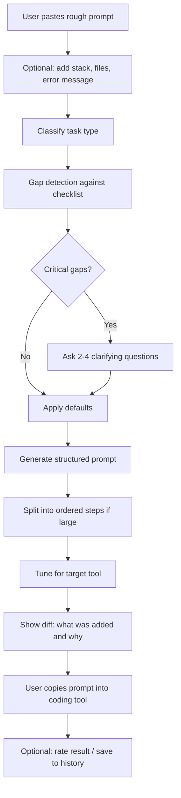

# Vibecoder Prompt Optimizer

Turn a rough idea into a clear, complete prompt that gets the right code on the first try.

> **Status:** Concept / pre-MVP. Commands and file names below describe the planned design and will change as the project is built.

---

## What It Does

Most vibecoding prompts fail because they are **incomplete**, not because they are badly worded. This tool:

1. Finds what your prompt is missing
2. Asks only the few questions that matter (2-4 max)
3. Fills in sensible defaults for everything else
4. Outputs a structured prompt tuned for your coding tool
5. Shows what changed and why, so you get better at prompting

---

## Complete Workflow

### End-to-end flow



### Step-by-step

| # | Stage | What happens | Output |
|---|---|---|---|
| 1 | **Intake** | User pastes a rough prompt and optionally adds context (stack, relevant files, error text) | Raw input |
| 2 | **Classify** | Detect task type: new app, add feature, fix bug, refactor, UI design | Task type |
| 3 | **Gap detection** | Compare the prompt to the checklist for that task type | List of missing items |
| 4 | **Clarify** | Ask up to 4 questions (tappable options where possible) for gaps that cannot be safely defaulted | User answers |
| 5 | **Defaults** | Fill remaining gaps with sensible defaults and show them so the user can override | Assumptions list |
| 6 | **Generate** | Build the structured prompt (see format below); split large requests into ordered steps | Optimized prompt |
| 7 | **Target tuning** | Adapt format for Cursor, Claude Code, Lovable, Bolt, v0, ChatGPT, etc. | Tool-specific prompt |
| 8 | **Explain** | Show a diff with a one-line reason for each addition | Before/after view |
| 9 | **Deliver** | Copy button; optional save to history | Final prompt |
| 10 | **Feedback** | Optional thumbs up/down or "worked first try?" | Data to improve templates |

---

## Example

**Input (rough prompt)**

```
make me a todo app
```

**Questions asked**

1. Which stack? (React + Vite / Next.js / plain HTML/JS / other)
2. Where should data live? (browser only / database)
3. Design feel? (minimal / colorful / dashboard)

**Output (optimized prompt)**

```
GOAL:
Build a todo app where a user can add, complete, edit and delete tasks.

CONTEXT:
Single-user personal tool; no login required.

STACK:
React + Vite, plain CSS. No UI libraries.

REQUIREMENTS:
1. Add a task with a title
2. Mark a task complete/incomplete
3. Edit and delete tasks
4. Filter by All / Active / Completed
5. Persist tasks in the browser across reloads

CONSTRAINTS:
- Keep it to a small number of files; no unnecessary abstractions
- Mobile-friendly layout
- Do not add features beyond those listed

OUTPUT FORMAT:
List the files created, then provide the full code for each.

ACCEPTANCE:
App runs with `npm run dev`; all five requirements work with no console errors.
```

**Diff shown to the user**

- Added stack (you did not specify one; models otherwise guess)
- Added persistence requirement (asked, answered "browser only")
- Added constraint against extra features (prevents over-building)
- Added acceptance criteria (defines "done")

---

## Optimized Prompt Format

```
GOAL:            one-sentence outcome
CONTEXT:         what exists already, who it is for
STACK:           language, framework, versions, libraries
REQUIREMENTS:    numbered, testable items
CONSTRAINTS:     what to avoid, limits, style rules
STEPS:           ordered build plan (for large tasks)
OUTPUT FORMAT:   files expected, how to present changes
ACCEPTANCE:      how we know it is done
```

Plain text/Markdown is used on purpose so any LLM understands it without extra explanation tokens.

---

## Task-Type Checklists

The gap detector checks your prompt against a checklist for its task type.

**New app:** purpose, main user flow, stack, hosting target, core vs. nice-to-have features, design feel, data storage

**Add feature:** existing stack, relevant files, exact behavior, edge cases, what must not break

**Fix bug:** exact error or symptom, reproduction steps, expected vs. actual behavior, code snippet, environment

**Refactor:** goal (readability, speed, structure), files in scope, behavior that must stay identical, tests available

**UI design:** screens and components, style references, colors, responsiveness, accessibility

---

## Planned Architecture

```
┌──────────┐     ┌───────────┐     ┌──────────────────────────────┐
│  Web UI  │ --> │    API    │ --> │ LLM call 1: classify + gaps  │
└──────────┘     └───────────┘     │             + questions      │
                                   ├──────────────────────────────┤
                                   │ LLM call 2: final prompt     │
                                   │             + diff           │
                                   └──────────────────────────────┘
                        ▲
                        │ reads
              ┌─────────┴─────────┐
              │ templates/ config │  (task checklists, tool presets)
              └───────────────────┘
```

- Two LLM calls for the MVP
- No accounts or database at first
- Checklists and tool presets live in versioned config files so they can be improved without code changes

### Proposed project structure

```
prompt-optimizer/
├── README.md
├── src/
│   ├── classify/        # task type detection
│   ├── gaps/            # checklist comparison
│   ├── questions/       # clarifying question generation
│   ├── generate/        # structured prompt builder
│   ├── presets/         # per-tool output tuning
│   └── diff/            # before/after explanation
├── templates/
│   ├── checklists/      # one file per task type
│   └── presets/         # one file per target tool
├── evals/
│   ├── cases/           # rough prompts + expected qualities
│   └── run.*            # compares original vs. optimized results
└── docs/
    └── prompt-optimizer-project.md
```

---

## Getting Started (planned)

```bash
# 1. Clone
git clone <your-repo-url>
cd prompt-optimizer

# 2. Install dependencies
<install command for your chosen stack>

# 3. Configure your LLM provider key
cp .env.example .env
# then set the API key in .env

# 4. Run locally
<dev command for your chosen stack>
```

Open the app, paste a rough prompt, answer the questions, and copy the result.

---

## Development Workflow

1. **Collect real prompts.** Gather 50-100 rough vibecoding prompts and label their common gaps.
2. **Write checklists.** One per task type; start with new app, add feature, fix bug, UI design.
3. **Build the pipeline.** Classify, detect gaps, ask, generate, diff.
4. **Add tool presets.** Start with the one or two tools your users rely on most.
5. **Evaluate.** For each test prompt, run the original and the optimized version in a coding tool and record whether the result worked on the first try and how many iterations were needed.
6. **Iterate on templates.** Update checklists and presets based on eval results and user feedback.
7. **Release.** Ship the MVP, then add project memory, history, and plugins.

---

## How Success Is Measured

| Metric | Question it answers |
|---|---|
| First-attempt success rate | Does the optimized prompt produce working code on the first try more often? |
| Iterations to completion | Are there fewer back-and-forth rounds? |
| Question completion rate | Do users finish the clarify step? |
| Prompt length vs. quality | Is the prompt lean, or bloated for little gain? |
| Return usage | Do users come back for a second prompt? |

---

## Roadmap

- [ ] Collect sample prompts and label gaps
- [ ] Draft checklists for the top task types
- [ ] MVP web app: intake, questions, output, diff, copy
- [ ] Evaluation harness (original vs. optimized)
- [ ] Tool-specific presets
- [ ] Project memory (store stack and conventions once)
- [ ] Prompt history and versioning
- [ ] Browser extension / IDE plugin
- [ ] Optional token-trimming step

---

## Design Principles

- **Interrogate first, rewrite second.** Missing information matters more than better wording.
- **Never over-ask.** Two to four questions, always skippable, with defaults.
- **Stay lean.** A longer prompt is not automatically a better one.
- **Teach, do not just fix.** Always show what changed and why.
- **Measure, do not assume.** Optimization gains vary by task, so test each task type.

---

## Related Work

- **LLMLingua** (Microsoft, EMNLP 2023): prompt compression using a small model to remove unimportant tokens. https://www.microsoft.com/en-us/research/blog/llmlingua-innovating-llm-efficiency-with-prompt-compression/
- **TOON (Token-Oriented Object Notation):** compact format for structured data in prompts. https://www.infoq.com/news/2025/11/toon-reduce-llm-cost-tokens
- **The Prompt Report:** survey of prompting and prompt optimization techniques. https://arxiv.org/pdf/2406.06608
- **DSPy:** framework for algorithmically optimizing prompts; gains vary by task. https://arxiv.org/html/2507.03620v1

---

## Contributing

1. Fork the repo and create a branch
2. Add or improve a checklist, preset, or eval case
3. Include at least one before/after prompt example showing the improvement
4. Open a pull request describing what you changed and why

---

## License

To be decided.
